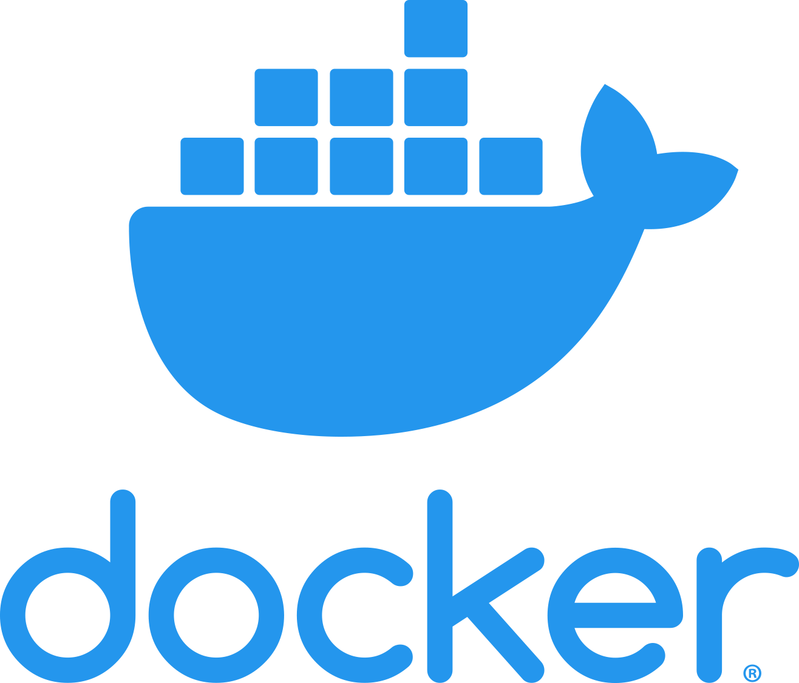

# SENAITE Docker
<p align="left">
  
  
  
</p>

Resources to build custom Docker image for SENAITE

Image is available on Docker Hub at
[mekomsolutions/senaite](https://hub.docker.com/r/mekomsolutions/openmrs/tags)

## Run the project

```
docker-compose up
```

### Environment variables

Additionally, the image will accept the following environment variable when run:

| Variable name                  | Default |                                    Description                                   |
|--------------------------------|---------|:--------------------------------------------------------------------------------:|
| `ADMIN_USER`                       |         | Name of the administrator user   
| `ADMIN_PASSWORD`                      |  | Password of the administrator  user name                        
| `SITE` |         | The 'site' name, eg, 'clinic1' |
| `ZODB_CACHE_SIZE` | `30000` | Number of objects kept in the ZODB cache per connection. Raising it (e.g. `100000`–`300000`) speeds up large SENAITE sites at the cost of RAM |
| `WSGI_THREADS` | `4` | Number of WSGI worker threads per instance (each thread holds its own ZODB cache) |
| `ZEO_CLIENT_CACHE_SIZE` | `128MB` | ZEO client cache size (only when `ZEO_ADDRESS` is set) |
| `BUILDOUT_SKIP_IF_UNCHANGED` | `false` | When `true`, skip re-running buildout at startup if `custom.cfg` has not changed since the last successful run. Faster restarts, but `plonesite` profiles are no longer re-applied on every restart |

### Volumes

#### Config volume
`/data/importdata/senaite`: Place where to drop a initial data.tar.gz file to import data on first start.

#### Data volumes
`/data`: SENAITE data storage path
